# Published figures, recreated

Fourteen well-known figures from a dozen fields, and ten figures from six
landmark open-access Nature papers, rebuilt in Inklet from the data behind
them. Each lives in [`examples/published/`](../examples/published/) with its
data, a `SOURCE.md` (full citation, data URL, licence, retrieval date and any
processing) and a `NOTES.md` that says what matches the original and what
differs. Every script reports no lint warnings.

Original figure images are not reproduced here; follow the citations to see
them. Where a published figure needed data that is not public, the notes say
what was left out.

## Landmark Nature papers: faithful and improved

Six papers from Nature and Nature Physics, all published under
[CC BY 4.0](https://creativecommons.org/licenses/by/4.0/) with the numbers
behind their figures released. Each figure is drawn twice:

* **Faithful** (`figN.py`): the original's print width (measured from its type),
  layout, colours, ranges and frame. Physics figures use the journal frame,
  `i.preset("scientific.nature", axes="box")`: a black box with inward major
  and minor ticks.
* **Improved** (`figN_improved.py`): the same data and every uncertainty, with
  the original's weak points fixed: colour-blind-safe colours, direct labels
  instead of distant keys, less overplotting, better scales. Explanations stay
  out of the figure; each `NOTES.md` has a suggested Nature legend instead.

### JWST: carbon dioxide in an exoplanet atmosphere

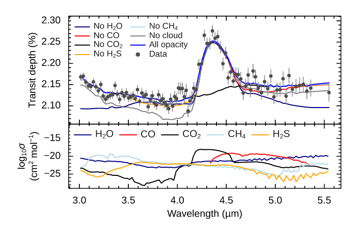
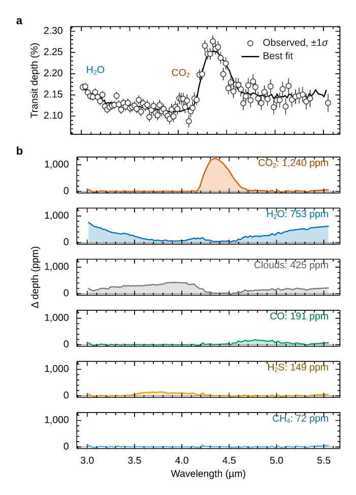

JWST Transiting Exoplanet Community ERS Team, "Identification of carbon dioxide
in an exoplanet atmosphere", *Nature* 614, 649–652 (2023),
[doi:10.1038/s41586-022-05269-w](https://doi.org/10.1038/s41586-022-05269-w), Fig. 3.
The improved version replaces seven overlapping model curves with one strip per
gas, on a shared scale, showing how much each adds to the spectrum.
[Faithful](../examples/published/jwst_wasp39b_2023/fig3.py) ·
[improved](../examples/published/jwst_wasp39b_2023/fig3_improved.py) ·
[notes](../examples/published/jwst_wasp39b_2023/NOTES.md)

### ATLAS: the Higgs boson's couplings, ten years on

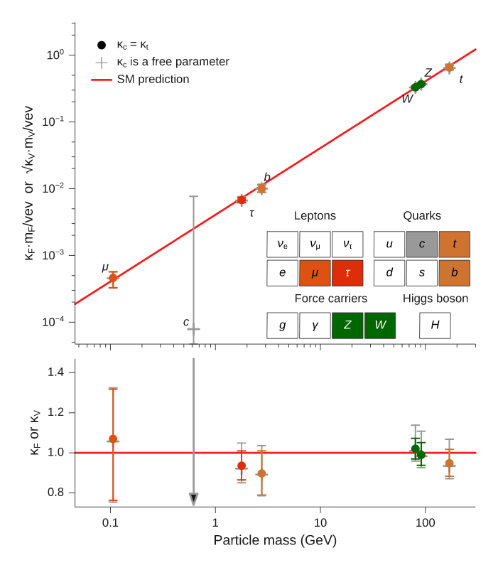
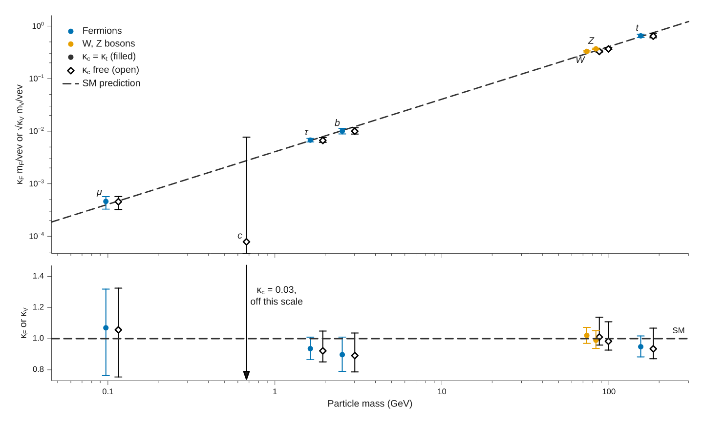

ATLAS Collaboration, "A detailed map of Higgs boson interactions by the ATLAS
experiment ten years after the discovery", *Nature* 607, 52–59 (2022),
[doi:10.1038/s41586-022-04893-w](https://doi.org/10.1038/s41586-022-04893-w), Fig. 5.
Data: HEPData record ins2104706. The improved version separates the two fit
scenarios by marker shape as well as colour and labels every particle at its point.
[Faithful](../examples/published/atlas_higgs_2022/fig5.py) ·
[improved](../examples/published/atlas_higgs_2022/fig5_improved.py) ·
[notes](../examples/published/atlas_higgs_2022/NOTES.md)

### KATRIN: neutrino mass below one electronvolt

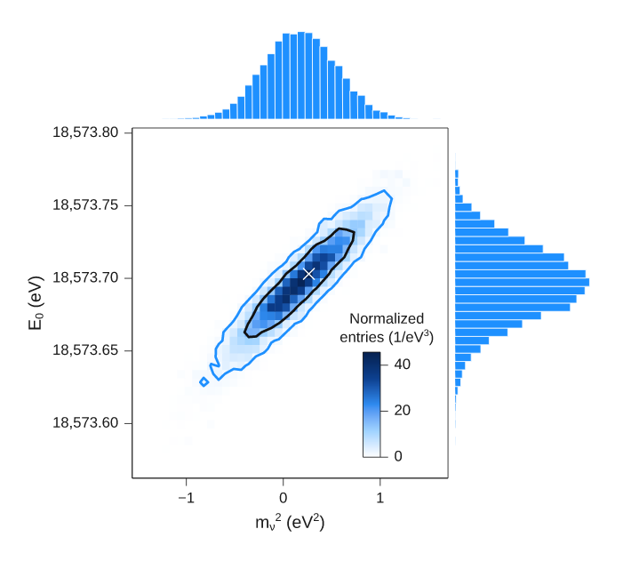
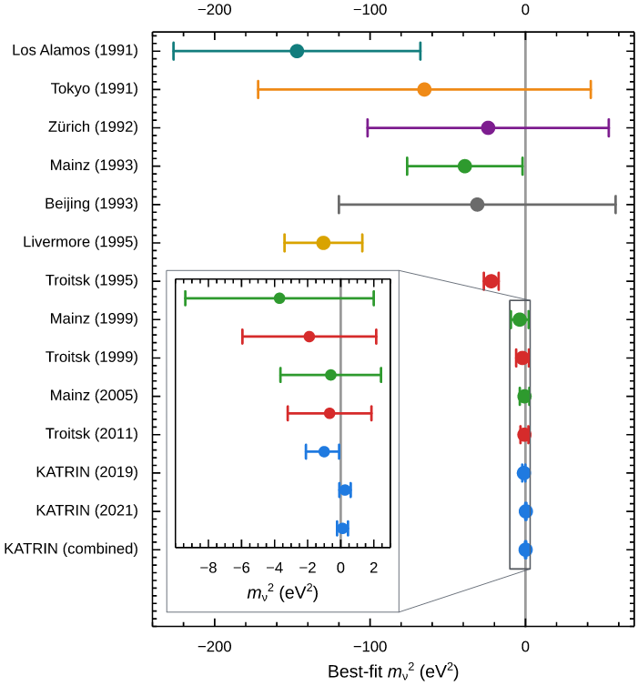
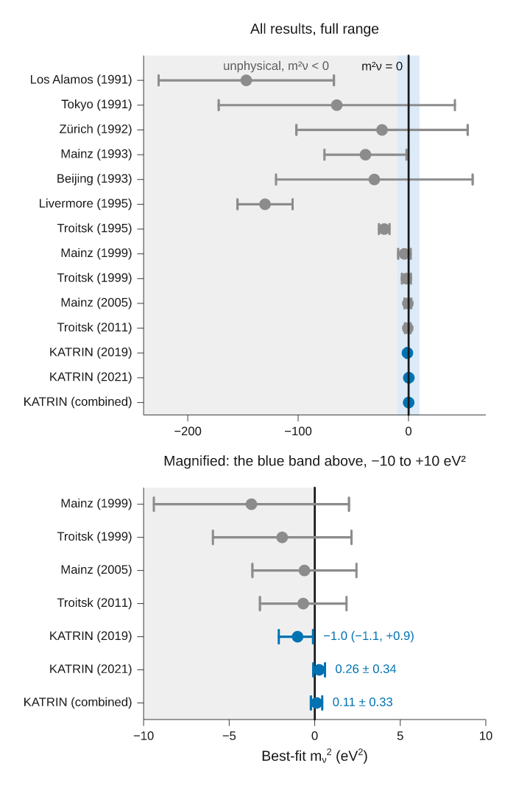

KATRIN Collaboration, "Direct neutrino-mass measurement with sub-electronvolt
sensitivity", *Nature Physics* 18, 160–166 (2022),
[doi:10.1038/s41567-021-01463-1](https://doi.org/10.1038/s41567-021-01463-1), Figs 3 and 4.
The contours are the histogram's highest-density regions, drawn with
`Panel.contour(..., hdr=(0.683, 0.954))`. In the improved Fig. 4, the
early results' errors of hundreds of eV² no longer squash KATRIN's ±0.3 eV²
into a sliver.
[Fig. 3](../examples/published/katrin_2022/fig3.py) ·
[Fig. 3 improved](../examples/published/katrin_2022/fig3_improved.py) ·
[Fig. 4](../examples/published/katrin_2022/fig4.py) ·
[Fig. 4 improved](../examples/published/katrin_2022/fig4_improved.py) ·
[notes](../examples/published/katrin_2022/NOTES.md)

### Human height: a saturated map of common variants

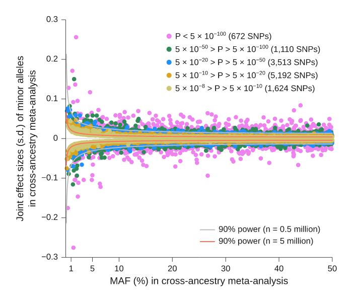
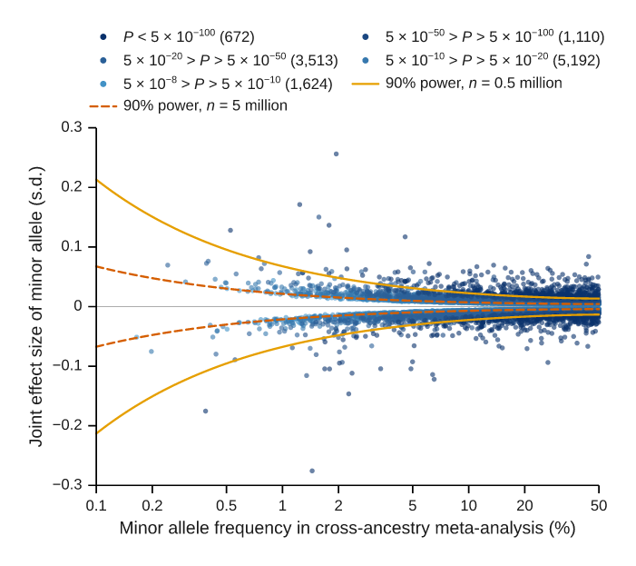

L. Yengo *et al.*, "A saturated map of common genetic variants associated with
human height", *Nature* 610, 704–712 (2022),
[doi:10.1038/s41586-022-05275-y](https://doi.org/10.1038/s41586-022-05275-y), Figs 1 and 2.
The improved Fig. 1 puts allele frequency on a log axis, where the rare variants
crowded against the left edge of the original spread out, and colours the
ordered P-value classes with an ordered ramp.
[Fig. 1](../examples/published/yengo_height_2022/fig1.py) ·
[Fig. 1 improved](../examples/published/yengo_height_2022/fig1_improved.py) ·
[Fig. 2](../examples/published/yengo_height_2022/fig2.py) ·
[notes](../examples/published/yengo_height_2022/NOTES.md)

### Brain-wide association studies need thousands of people

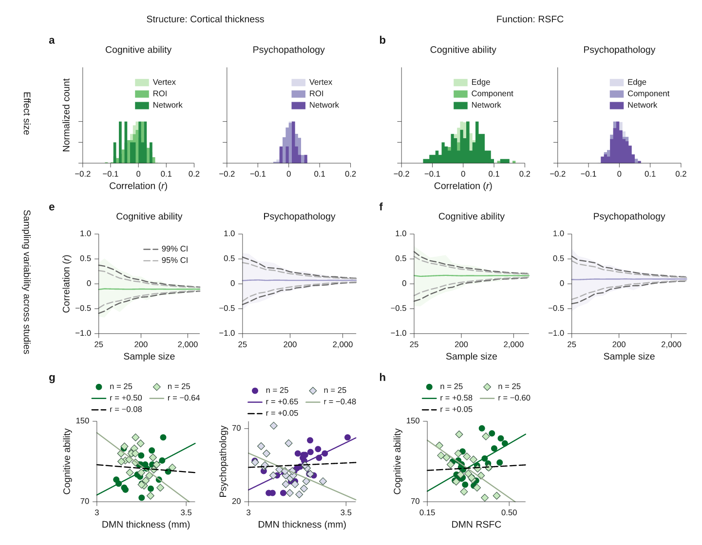
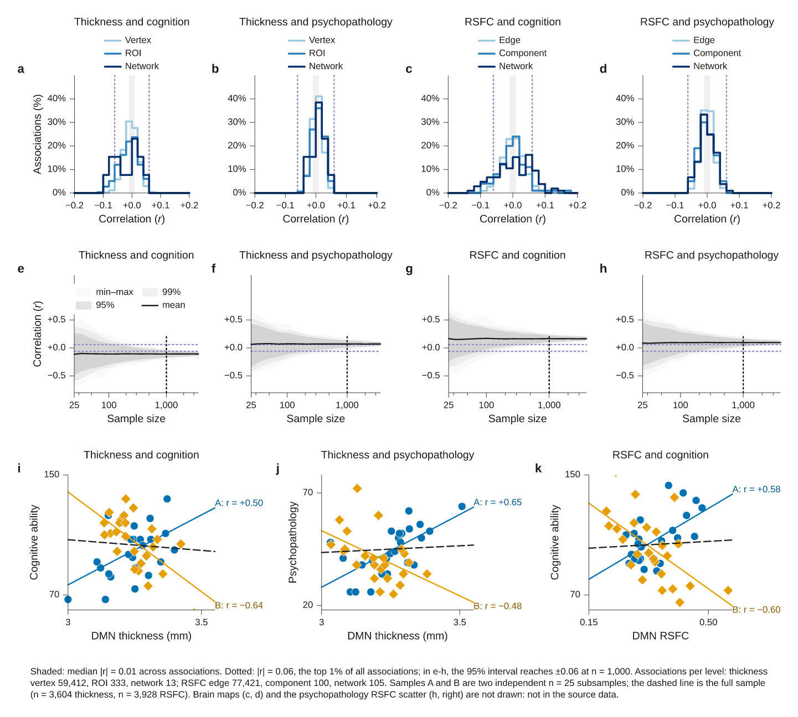

S. Marek *et al.*, "Reproducible brain-wide association studies require
thousands of individuals", *Nature* 603, 654–660 (2022),
[doi:10.1038/s41586-022-04492-9](https://doi.org/10.1038/s41586-022-04492-9), Fig. 1
(panels a, b and e–h; the brain maps in c and d are not in the source data).
[Faithful](../examples/published/marek_bwas_2022/fig1.py) ·
[improved](../examples/published/marek_bwas_2022/fig1_improved.py) ·
[notes](../examples/published/marek_bwas_2022/NOTES.md)

### WHO: excess mortality during the COVID-19 pandemic

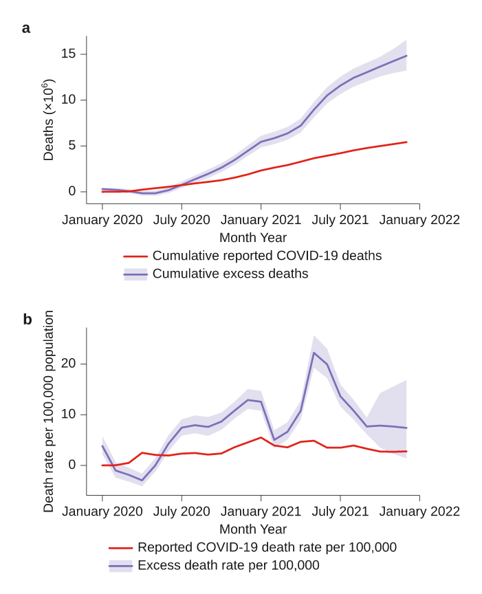
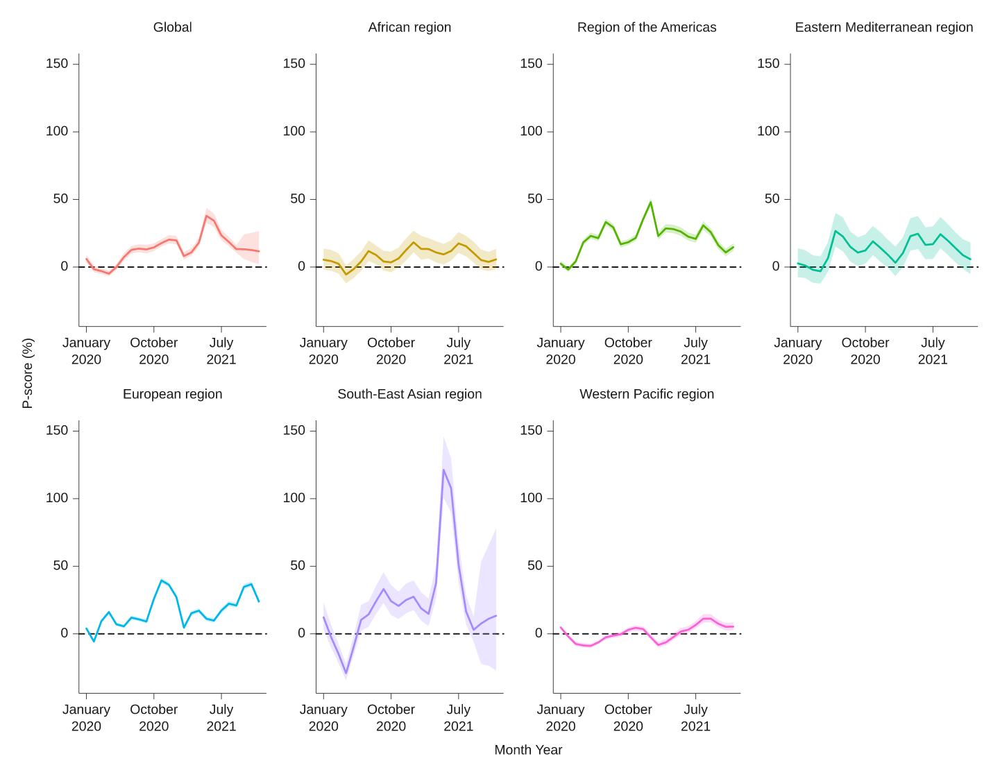
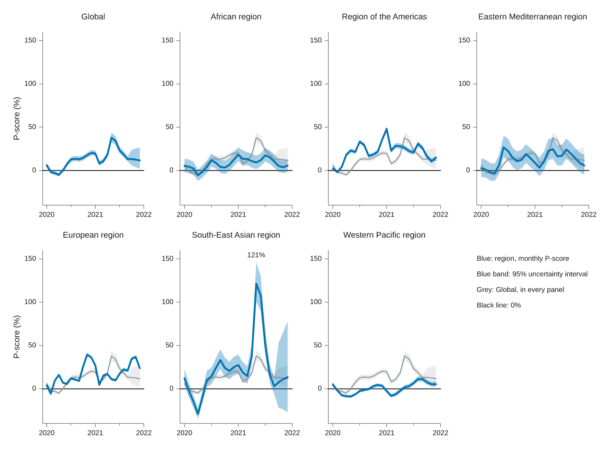

W. Msemburi *et al.*, "The WHO estimates of excess mortality associated with
the COVID-19 pandemic", *Nature* 613, 130–137 (2023),
[doi:10.1038/s41586-022-05522-2](https://doi.org/10.1038/s41586-022-05522-2), Figs 1, 2 and 5.
The improved Fig. 2 drops seven meaningless colours for one, and puts the
global series behind every region so each can be read against it.
[Fig. 1](../examples/published/who_excess_2023/fig1.py) ·
[Fig. 2](../examples/published/who_excess_2023/fig2.py) ·
[Fig. 2 improved](../examples/published/who_excess_2023/fig2_improved.py) ·
[Fig. 5](../examples/published/who_excess_2023/fig5.py) ·
[notes](../examples/published/who_excess_2023/NOTES.md)

## Classic figures

Fourteen well-known figures, restyled in Inklet's default look rather than
copied pixel for pixel.

### Physics: the first gravitational-wave detection

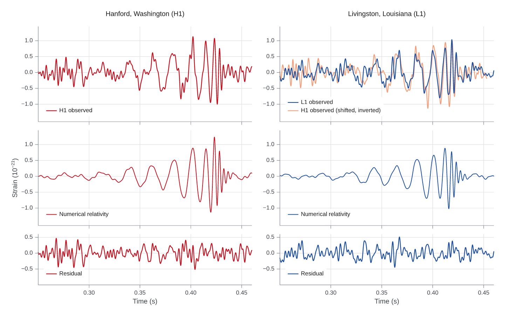

Abbott et al. (LIGO and Virgo Collaborations), "Observation of Gravitational
Waves from a Binary Black Hole Merger", *Phys. Rev. Lett.* 116, 061102 (2016),
[doi:10.1103/PhysRevLett.116.061102](https://doi.org/10.1103/PhysRevLett.116.061102), Figure 1.
Data: the GWOSC Figure 1 release (CC BY 4.0), unmodified. The three strain
rows are recreated; the spectrogram row and the 90% waveform bands are not
published as data. [Script](../examples/published/ligo_gw150914/figure.py) ·
[notes](../examples/published/ligo_gw150914/NOTES.md)

### Astronomy: Hubble's velocity–distance relation

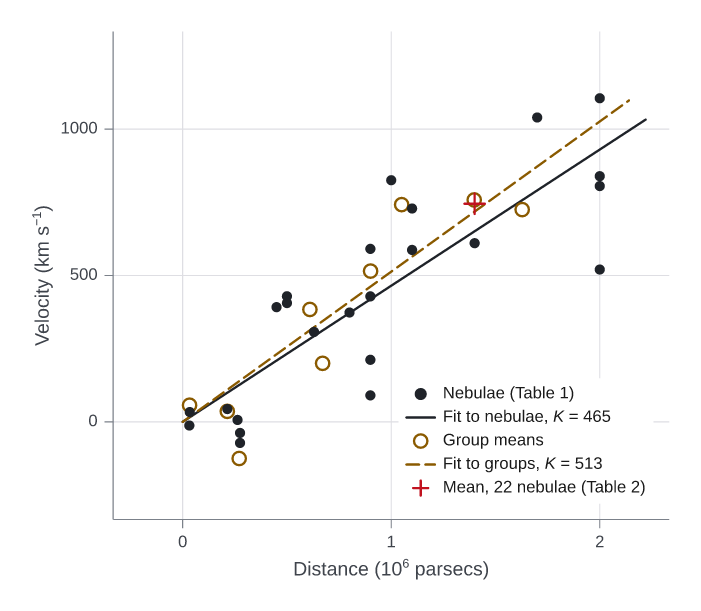

E. Hubble, "A relation between distance and radial velocity among
extra-galactic nebulae", *PNAS* 15, 168–173 (1929),
[doi:10.1073/pnas.15.3.168](https://doi.org/10.1073/pnas.15.3.168), Figure 1.
Data: Table 1 of the paper (public domain), with velocities corrected for solar
motion using Hubble's own solution; the refit reproduces his K = 465 km/s/Mpc.
Five of the nine group means are read from the printed figure.
[Script](../examples/published/hubble_1929/figure.py) ·
[notes](../examples/published/hubble_1929/NOTES.md)

### Climate: the Keeling curve

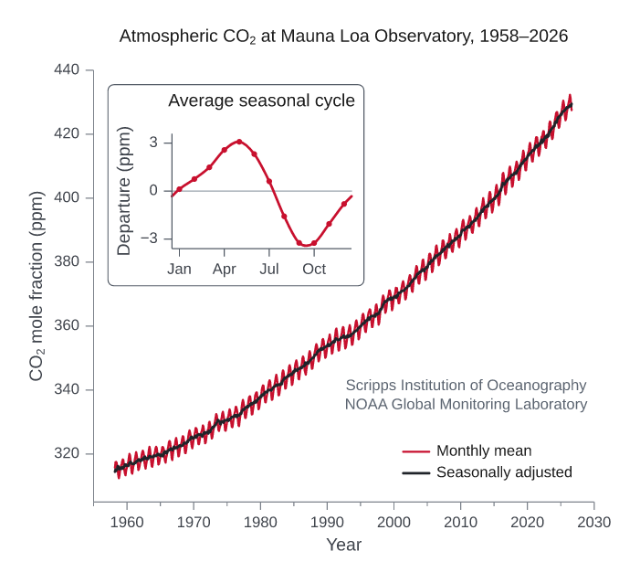

C. D. Keeling et al., "Atmospheric carbon dioxide variations at Mauna Loa
Observatory, Hawaii", *Tellus* 28, 538–551 (1976), and the NOAA GML / Scripps
record as published at gml.noaa.gov. Data: NOAA GML monthly means (public
domain), March 1958 to August 2026.
[Script](../examples/published/keeling_curve/figure.py) ·
[notes](../examples/published/keeling_curve/NOTES.md)

### Ecology: Palmer penguins

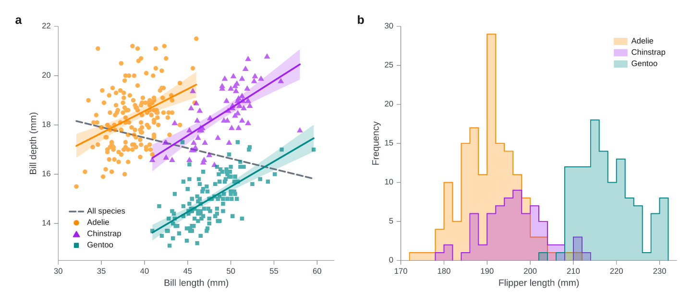

K. B. Gorman, T. D. Williams & W. R. Fraser, "Ecological sexual dimorphism and
environmental variability within a community of Antarctic penguins (genus
*Pygoscelis*)", *PLoS ONE* 9, e90081 (2014),
[doi:10.1371/journal.pone.0090081](https://doi.org/10.1371/journal.pone.0090081),
as packaged and plotted by Horst, Hill & Gorman (palmerpenguins, CC0). Panel a
shows Simpson's paradox: the pooled slope is negative, every species' slope
positive. [Script](../examples/published/palmer_penguins/figure.py) ·
[notes](../examples/published/palmer_penguins/NOTES.md)

### Medicine: survival in advanced lung cancer

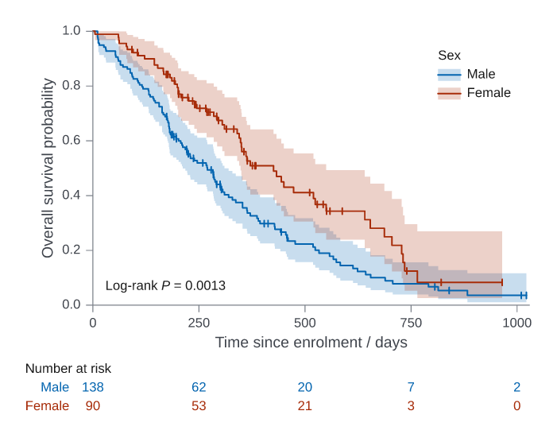

Loprinzi et al., "Prospective evaluation of prognostic variables from
patient-completed questionnaires", *J. Clin. Oncol.* 12, 601–607 (1994),
[doi:10.1200/JCO.1994.12.3.601](https://doi.org/10.1200/JCO.1994.12.3.601).
The trial's data are R's `survival::lung`; this Kaplan–Meier plot by sex is
their standard published presentation (R `survival` and survminer
documentation), not a figure printed in the paper. Medians, at-risk counts and
the log-rank P = 0.0013 match R.
[Script](../examples/published/ncctg_lung/figure.py) ·
[notes](../examples/published/ncctg_lung/NOTES.md)

### Genomics: glucocorticoid response in airway smooth muscle

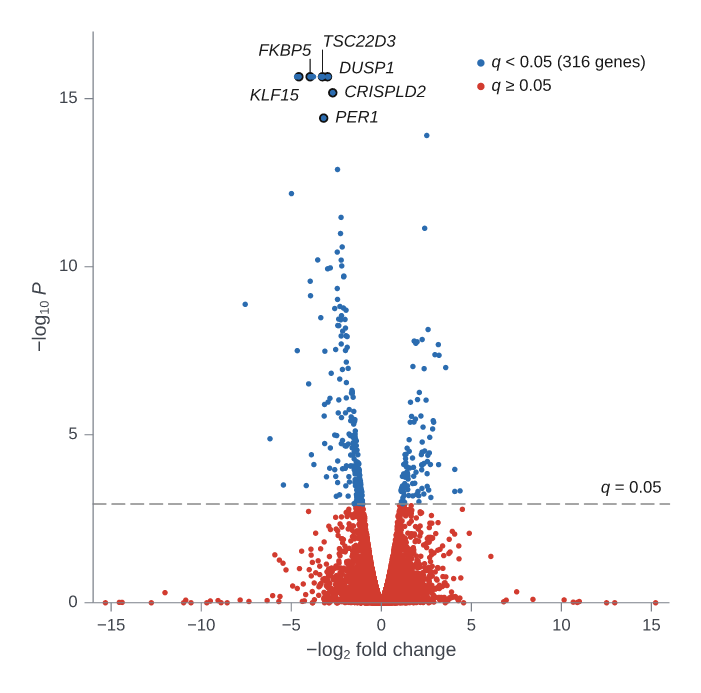

Himes et al., "RNA-Seq transcriptome profiling identifies CRISPLD2 as a
glucocorticoid responsive gene that modulates cytokine function in airway
smooth muscle cells", *PLoS ONE* 9, e99625 (2014),
[doi:10.1371/journal.pone.0099625](https://doi.org/10.1371/journal.pone.0099625), Figure 1A.
Data: the authors' Cuffdiff results deposited with the paper (GEO GSE52778);
316 genes at q < 0.05, as in the caption. Gene labels are added.
[Script](../examples/published/rnaseq_volcano/figure.py) ·
[notes](../examples/published/rnaseq_volcano/NOTES.md)

### Development: health and wealth of nations

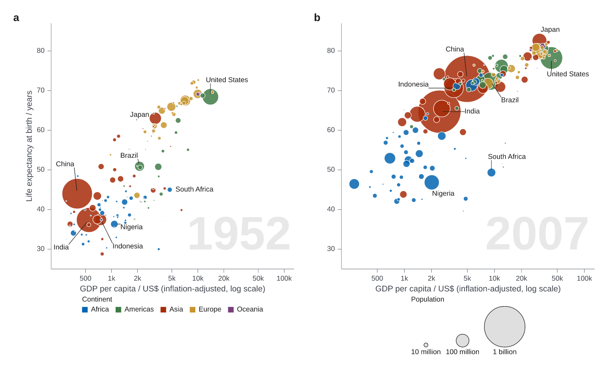

Hans Rosling's Gapminder chart (Gapminder Foundation; Rosling, Rosling &
Rosling Rönnlund, *Factfulness*, 2018), with the `gapminder` data excerpt
(CC0; Gapminder data CC BY 4.0). Bubble area is population; 1952 and 2007
share their axes. [Script](../examples/published/gapminder/figure.py) ·
[notes](../examples/published/gapminder/NOTES.md)

### Statistics: Anscombe's quartet

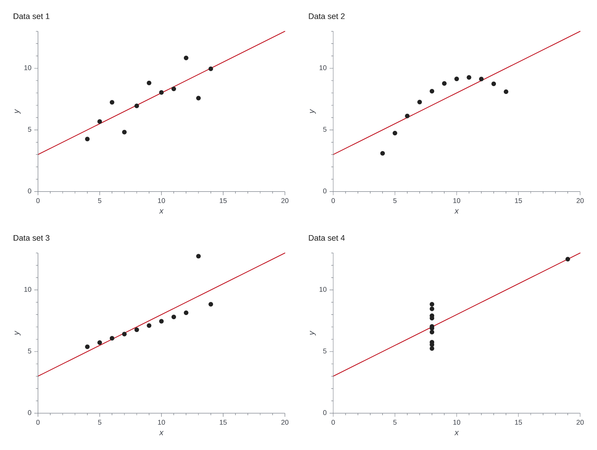

F. J. Anscombe, "Graphs in Statistical Analysis", *The American Statistician*
27, 17–21 (1973),
[doi:10.1080/00031305.1973.10478966](https://doi.org/10.1080/00031305.1973.10478966),
Figures 1–4. Data: the paper's table, checked value by value.
[Script](../examples/published/anscombe_1973/figure.py) ·
[notes](../examples/published/anscombe_1973/NOTES.md)

### Cosmology: the cosmic microwave background spectrum

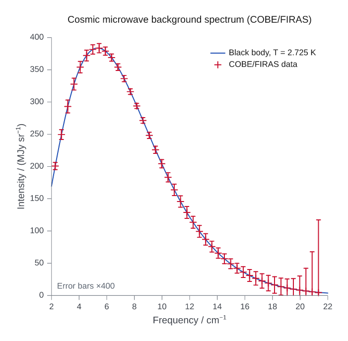

Mather et al., *ApJ* 420, 439 (1994), [doi:10.1086/173574](https://doi.org/10.1086/173574),
and Fixsen et al., *ApJ* 473, 576 (1996), [doi:10.1086/178173](https://doi.org/10.1086/178173).
Data: the FIRAS monopole spectrum from NASA LAMBDA (public domain); the
blackbody is Planck's law at 2.725 K. Error bars are drawn at 400σ, as in the
well-known version of the figure.
[Script](../examples/published/cobe_firas_cmb/figure.py) ·
[notes](../examples/published/cobe_firas_cmb/NOTES.md)

### Seismology: the Gutenberg–Richter law

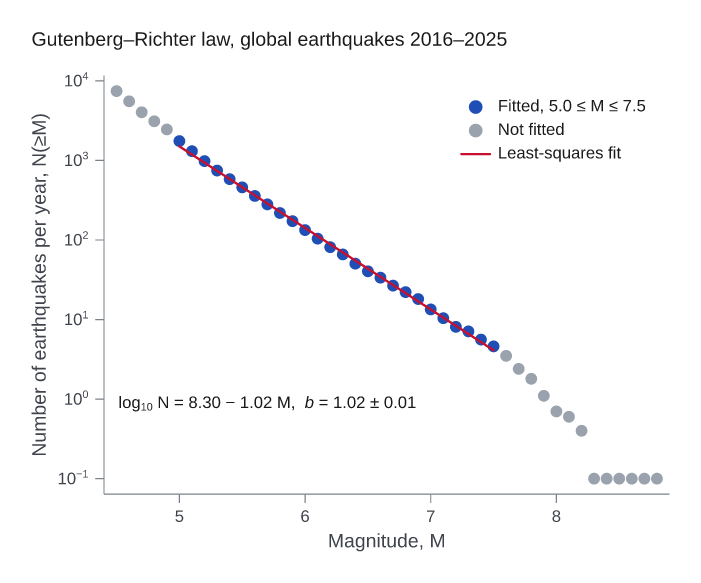

B. Gutenberg & C. F. Richter, "Frequency of earthquakes in California",
*BSSA* 34, 185–188 (1944), [doi:10.1785/BSSA0340040185](https://doi.org/10.1785/BSSA0340040185).
The 1944 paper has tables but no figure; this is the law's standard plot, built
from the USGS global catalogue for 2016–2025 (public domain). The fit over
5.0 ≤ M ≤ 7.5 gives b = 1.02.
[Script](../examples/published/gutenberg_richter/figure.py) ·
[notes](../examples/published/gutenberg_richter/NOTES.md)

### Population ecology: hare and lynx cycles

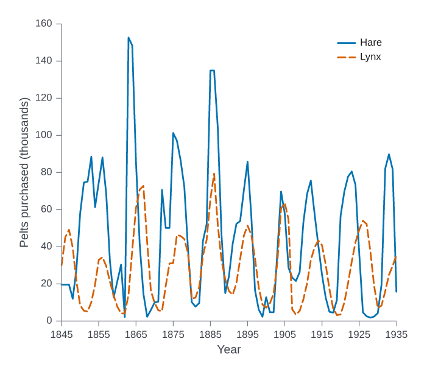

MacLulich (1937) and C. Elton & M. Nicholson, "The ten-year cycle in numbers
of the lynx in Canada", *J. Anim. Ecol.* 11, 215–244 (1942),
[doi:10.2307/1358](https://doi.org/10.2307/1358), as plotted in Odum's
*Fundamentals of Ecology*. Data: the yearly pelt counts, checked against two
independent transcriptions. [Script](../examples/published/hare_lynx/figure.py) ·
[notes](../examples/published/hare_lynx/NOTES.md)

### Psychology: Ebbinghaus's forgetting curve

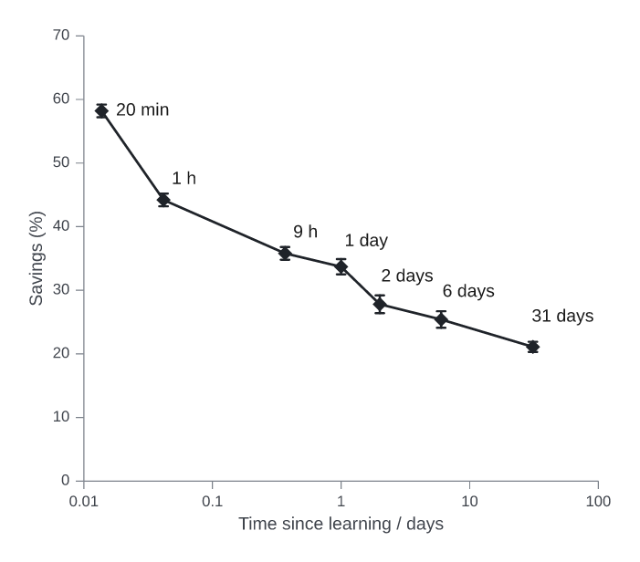

H. Ebbinghaus, *Über das Gedächtnis* (1885; English translation 1913), the
savings table, checked against the German text and against Murre & Dros,
*PLoS ONE* 10, e0120644 (2015), [doi:10.1371/journal.pone.0120644](https://doi.org/10.1371/journal.pone.0120644).
[Script](../examples/published/ebbinghaus_1885/figure.py) ·
[notes](../examples/published/ebbinghaus_1885/NOTES.md)

### Epidemiology: John Snow's cholera map

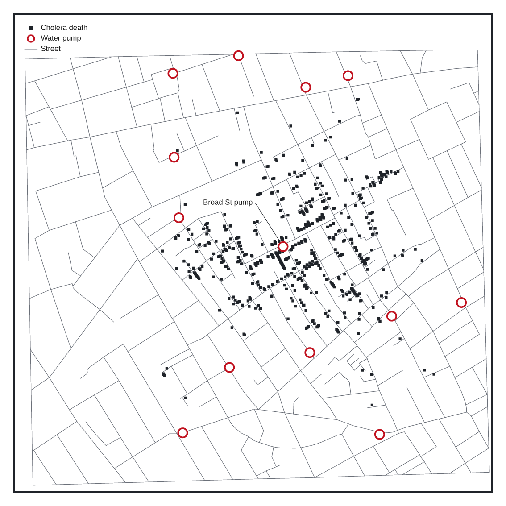

J. Snow, *On the Mode of Communication of Cholera*, 2nd ed. (1855), Map 1.
Data: the digitization in the R package HistData (GPL; 578 deaths, 13 pumps),
drawn at equal scale on both axes.
[Script](../examples/published/snow_cholera_1854/figure.py) ·
[notes](../examples/published/snow_cholera_1854/NOTES.md)

### Physiology: the Hodgkin–Huxley action potential

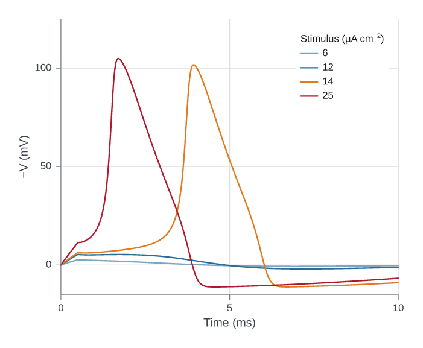

A. L. Hodgkin & A. F. Huxley, "A quantitative description of membrane current
and its application to conduction and excitation in nerve", *J. Physiol.* 117,
500–544 (1952), [doi:10.1113/jphysiol.1952.sp004764](https://doi.org/10.1113/jphysiol.1952.sp004764).
Unlike the others, this figure is **computed** from the paper's equations and
constants at 6.3 °C (RK4, 1 µs steps), in the paper's sign convention; it was
not checked against the printed figure, which could not be accessed.
[Script](../examples/published/hodgkin_huxley_1952/figure.py) ·
[notes](../examples/published/hodgkin_huxley_1952/NOTES.md)

## Rebuild them

```sh
for script in examples/published/*/figure.py examples/published/*/fig*.py; do python "$script"; done
```

The scripts write to `gallery/published/`. They need pandas and NumPy for
reading the data files, and PyYAML for the ATLAS HEPData tables.
